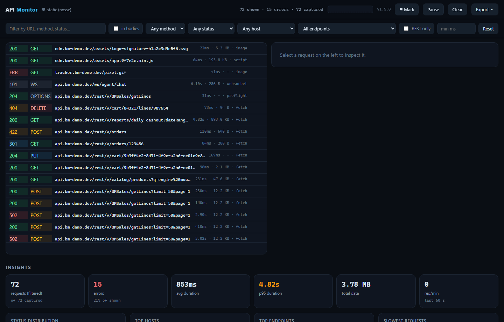
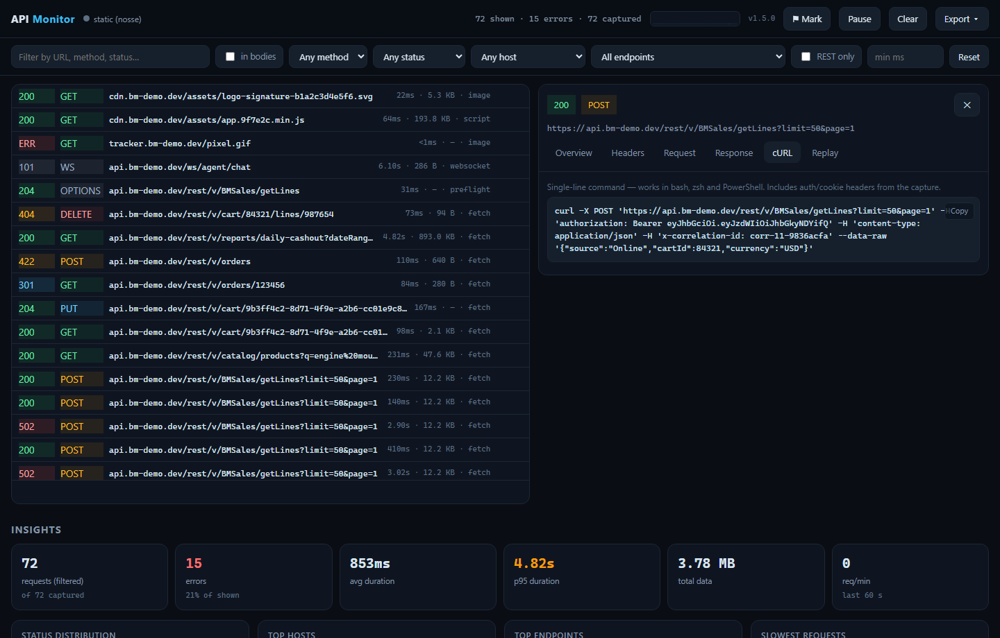
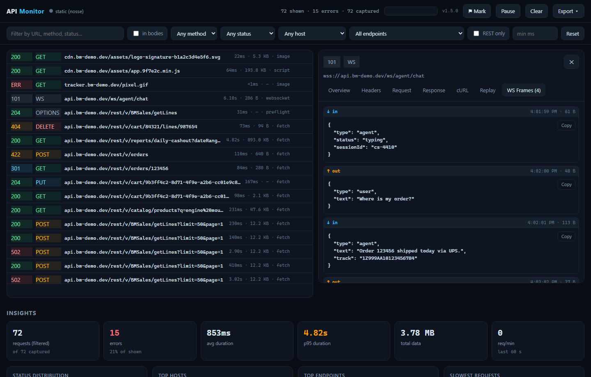
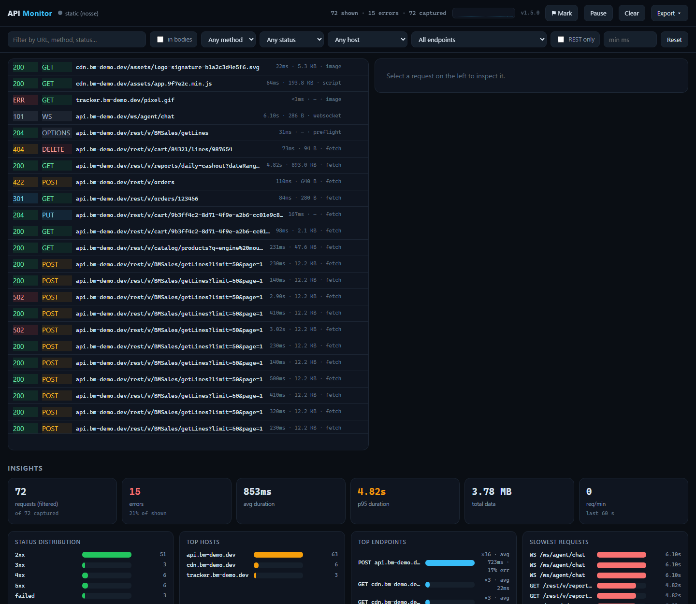

# API Monitor

A two-part tool to watch the API/network calls a webpage makes, and analyze them on a
custom local dashboard:

```
webpage (any tab)          Chrome extension             standalone app (Node.js)
┌────────────────┐   CDP network events   ┌──────────────────┐   POST /events   ┌─────────────────────────┐
│  app you use   │◀───────────────────────│  API Monitor     │─────────────────▶│ • ingests + stores calls │
└────────────────┘     chrome.debugger    │  Bridge (MV3)    │  local HTTP      │ • live dashboard + SSE   │
                                          └──────────────────┘                  │ • insights & analytics   │
                                                                                └─────────────────────────┘
```

- **Chrome extension** — uses the Chrome DevTools Protocol (`chrome.debugger` → `Network.*`)
  to capture the requests of the tab you toggle it on: URLs, methods, status codes, headers,
  timings (TTFB/total), sizes, request **and response bodies**, initiators, redirects, errors.
- **Standalone app** — a zero-dependency Node.js server that receives the captures and serves a
  live dashboard at `http://127.0.0.1:8899` with filters, per-request inspection, and insights
  (status distribution, top hosts/endpoints, slowest requests, error rates, req/min timeline…).

Requests are kept locally: in memory (ring buffer) and appended to `app/data/requests.jsonl`,
so insights survive restarts. Nothing is sent anywhere beyond your own machine
(the server binds to `127.0.0.1` only).

## Screenshots

**Live dashboard** — capture list with status/method/URL/duration/size, filters,
insight tiles, and the 60-second traffic pulse:


**Request detail, cURL tab** — ready-to-paste single-line cURL (with a *Copy* button;
other tabs: overview waterfall, headers, request/response bodies, replay + diff, WS frames):


**WebSocket inspection** — captured frames with direction (↓ in / ↑ out), timing,
payload sizes and pretty-printed JSON:


**Insights** — status distribution, top hosts, endpoints with average call time,
slowest requests, error rates and traffic timeline:


> Deep links: open a specific captured request with `#r<id>` or `#r<id>/<tab>`
> (e.g. `/#r84/curl`) — handy for sharing a finding. Add `?nosse=1` to freeze
> the live feed (used for these screenshots, also good for clean comparisons).

## Quick start

**1. Start the standalone app** (requires Node.js 18+):

```bash
cd app
node server.js
# or: npm start
```

**2. Load the extension**

- Open `chrome://extensions` (works in Chrome / Edge / Brave)
- Enable **Developer mode** (top right)
- Click **Load unpacked** → select the `extension/` folder

**3. Capture**

- Open the dashboard: http://127.0.0.1:8899
- On any page you want to monitor, click the **API Monitor** extension icon → **Start capturing**
- Use the site normally; requests stream into the dashboard live
- Click the icon again (→ **Stop capturing**) to detach from that tab

You can capture several tabs at once — the popup toggles the *active* tab.

## What the dashboard gives you

- **Session control**: **Pause/Resume** freezes the live view while captures keep
  buffering (counter badge on the button); **⚑ Mark** drops labelled timestamp
  dividers between requests to annotate a debugging session (e.g. "clicked Checkout",
  "after fix")
- Live request list (status, method, URL, duration, size, type + WS frame counts)
  with search + filters (method, status class, host, minimum duration), a **REST only**
  toggle that hides static assets/scripts/CSS/images/page navigations, an
  **endpoint picker** (`All endpoints`) grouping calls by method + host + normalized
  path (`/users/42` → `/users/:id`) with count and **average call time** (also
  clickable in the "Top endpoints" insight chart), and **"in bodies"** server-side
  full-text search across request/response bodies, URLs and errors
- Per-request detail: overview with a waiting-vs-content timing bar, headers,
  pretty-printed request/response bodies (JSON auto-formatted, form data decoded),
  a **cURL tab** with a paste-ready single-line command (bash/zsh/PowerShell) plus a
  quick `curl` copy button on every list row, a **Replay tab** that re-issues the
  captured request and shows the fresh response **diffed side-by-side** against the
  captured one, and a **WS Frames tab** for captured WebSocket traffic
- Insights (reflect the active filters): totals, errors + error %, avg/p95 duration,
  data volume, req/min + a 60-second **traffic pulse sparkline** in the header, status
  distribution, top hosts, top endpoints, slowest requests, content types, timeline
- **Keyboard flow**: `/` search · `j`/`k` walk the list · `Enter` open · `c` copy cURL ·
  `Esc` close
- **Export menu**: JSON (full data) · **HAR** (DevTools/Charles-compatible) ·
  **cURL collection** (.sh, one command per capture)
- **Clear / Purge / Export**: wipe everything, delete selectively
  (`POST /api/purge` `{"host"…}`/`{"urlContains"…}`), download

### Keyboard shortcuts

| Key | Action |
|---|---|
| `/` | focus the search box (Esc leaves it) |
| `j` / `k` | move highlight down/up through the request list |
| `Enter` | open the highlighted request |
| `c` | copy the highlighted request's cURL command |
| `Esc` | close the detail panel / clear selection |

## Configuration

| Setting | Where | Default |
|---|---|---|
| App port | `PORT` env var when starting the server | `8899` |
| Persistence off | `PERSIST=0 node server.js` | on |
| In-memory record cap | `MAX_RECORDS=10000` | `5000` |

If you change the port, also update `SERVER` at the top of `extension/background.js`
(and the `Dashboard` fallback in `extension/popup.js`), then reload the extension.

## Good to know / limitations

- **The "debugging" banner**: when capturing, Chrome shows *"API Monitor Bridge started
  debugging this browser"*. That's unavoidable with `chrome.debugger` — it's also what makes
  reading full request/response bodies possible. Click "Cancel" or press **Stop capturing** to detach.
- **Per-tab capture**: only tabs you toggled are monitored, not the whole browser.
- **DevTools conflict**: if real DevTools is open on that tab, attaching may fail
  ("another debugger is already attached") — close it first.
- **Body caps**: bodies are truncated at ~200 KB each (flagged as truncated); binary bodies
  are reported as size only. WS frames: up to 80 frames × 16 KB per connection.
- **Replay fires real requests** to the captured target from the app process — the
  request carries the captured headers/body (including auth/cookie values); treat it
  like pasting a cURL into your terminal.
- **Marks are in-memory** only (server process lifetime) — records, not annotations,
  are the durable store.
- `chrome://` and Web Store pages can't be attached to.
- If the app isn't running, the extension buffers captures (up to ~2000) and retries —
  its toolbar badge shows `OFF`.

## Ideas for later

- HAR *import* / diffing two sessions, request rewriting before replay (edit headers
  and body in the UI), breakpoints via the `Fetch` domain (block/pause/modify),
  per-session persistence buckets, an Electron wrapper to bundle it as a desktop app.
